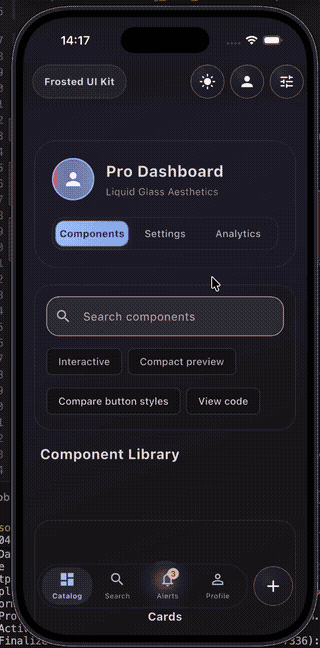

# 💧 Frosted UI Kit (`frosted_ui_kit`)

<p align="center">
  <a href="https://pub.dev/packages/frosted_ui_kit"></a>
  <a href="https://subultech.top/packages/frostuikit/demo/"></a>
  <a href="https://subultech.top/packages/frostuikit/"></a>
  <a href="LICENSE"></a>
</p>

A modern, highly-customizable Flutter UI kit inspired by **Apple's Liquid Glass** aesthetic and **Telegram's modern Android redesign**. `frosted_ui_kit` brings translucent backdrops, soft backdrop blurs, realistic glossy borders, fluid animations, and high-level control surfaces to your Flutter applications.

The 2.0 release combines a simple, token-driven API with adaptive rendering for
iOS, Android, web, and desktop. Start with the short `Frosted*` APIs, then use
the lower-level widgets and mixins when you need full control.

> 🚀 **Explore & Try Online:**
> - 📱 **[Interactive Live Web Demo ↗](https://subultech.top/packages/frostuikit/demo/)** — Test the kit directly in your browser.
> - 📚 **[Full Documentation & Widget Catalog ↗](https://subultech.top/packages/frostuikit/)** — Detailed API references, design tokens, and parameters.
> - 🧪 **[pub.dev Example ↗](https://pub.dev/packages/frosted_ui_kit/example)** — The runnable package example.
> - 📝 **[Changelog ↗](https://pub.dev/packages/frosted_ui_kit/changelog)** — Release notes and migration information.



---

## ✨ Features

- 🧊 **Glassmorphism & Liquid Aesthetics**: Soft backdrop blurs (`BackdropFilter`), custom translucent depth, realistic borders, and subtle shadows.
- 🧠 **Smart Platform Adaptation**: Intelligently uses `BackdropFilter` hardware acceleration via Impeller on iOS, and seamlessly falls back to smooth Alpha Transparency on Android for Telegram-like 60fps fluidity on all device tiers.
- ⚡ **Telegram-Style Fluidity**: Dynamic sliding tabs, responsive micro-animations, floating rounded containers, and interactive control surfaces.
- 📱 **Standardized Component Suite**:
  - **`BaseWidget`**: Foundational layout wrapper with integrated glassmorphic app bar (`FrostedAppBar`) and optional scroll-to-hide behavior.
  - **`BluredCard` & `Cards`**: Glassmorphic container widgets with customizable blur intensity.
  - **`AppButton` & `CircleButton`**: Multi-styled buttons supporting `glass`, `colored`, `outlined`, `text`, and `waterDrop` styles.
  - **`AppSlidingTabs` & `Tabs`**: Telegram-inspired smooth sliding segmented controls.
  - **`AppBottomSheet` & `BottomSheets`**: Glassmorphic modal bottom sheets.
  - **`AppTextField` & `Inputs`**: Standardized input fields with validation and theme support.

## 🧩 Ready-to-use widgets

Use this index when you are looking for a specific UI pattern:

| Area | Ready-to-use API | What it provides |
| --- | --- | --- |
| Screen layout | `BaseWidget` | Scaffold wrapper, safe spacing, floating app bar, optional scroll behavior, status-bar treatment, and navigation bar integration. |
| App bar | `FrostedAppBar` | Floating glass title bar with leading/trailing actions and scroll-aware hide/collapse behavior. |
| Bottom navigation | `FrostedNavigationBottomBar`, `FrostedNavbarItem`, `FrostedNavbarController` | Floating navigation with active-state animation and badges. The historical `FrostedNavigationButtomBar` name remains available. |
| Cards and surfaces | `BlurredCard`, `GlassBackdrop`, `FrostedAdaptiveSurfaceLayout` | Shared glass surfaces, backdrop treatment, and responsive modal surface layout. |
| Buttons | `FrostedButton`, `FrostedIconButton`, `AppButton`, `CircleButton`, `AppFloatingActionButton` | Primary, secondary, outlined, glass, water-drop, selected, disabled, loading, and destructive actions. |
| Async actions | `FrostedAsyncButton`, `FrostLoadingButton`, `FrostLoadingButtonController` | Loading, success, error, retry protection, and animated feedback states. |
| Inputs | `AppTextField`, `Inputs` | Text, email, password, name, phone, number, and multiline fields with validation and keyboard defaults. |
| Dialogs | `AppDialog`, `Dialogs` | Warning, error, input, loading, keyboard-aware, scrollable, and destructive dialogs. |
| Bottom sheets | `AppBottomSheet`, `BottomSheets` | Glass bottom sheets with safe-area, keyboard, narrow-screen, and action-layout support. |
| Tabs | `AppSlidingTabs`, `Tabs` | Animated segmented tabs with selected state, semantics, and RTL support. |
| Lists | `FrostedListSection`, `FrostedListTile` | Grouped glass settings lists with selected state, icon capsules, dividers, and semantic interaction. |
| Steppers | `FrostedStepper`, `Steppers`, `FrostedStepperController` | Horizontal or vertical progress steps with numbers or custom icons, images, Lottie, and widgets through `stepBuilder`. |
| Loading | `AppLoadingIndicator` | Reusable Lottie-based loading indicator. |
| Auth UI | `AuthScreen`, `AuthView` | Generic login, registration, reset-password, and email-verification screens with feature flags. |

For the complete API and copy-paste examples, open the
[widget catalog](https://subultech.top/packages/frostuikit/) or the generated
[API reference](https://pub.dev/documentation/frosted_ui_kit/latest/).
- 🔐 **Generic Authentication UI**: Pre-built, app-agnostic screens for Login, Register, Password Recovery, and Email Verification with optional feature flags to disable specific flows.
- 🌍 **Full Localization & Theme Ready**: Built to work seamlessly with `flutter_localizations` and dark/light themes.

---

## 🚀 Getting Started

Central design tokens can be installed through `ThemeData.extensions`:

```dart
ThemeData(
  extensions: const [FrostedThemeData(buttonRadius: 20, glassBlur: 4)],
)
```

Explicit widget overrides win over tokens. Without an extension the existing
defaults apply. See `doc/FROSTED_THEME.md` for coverage and migration details.

Add `frosted_ui_kit` to your `pubspec.yaml`:

```yaml
dependencies:
  frosted_ui_kit: ^2.0.0
```

Import the package:

```dart
import 'package:frosted_ui_kit/frosted_ui_kit.dart';
```

For a complete copy-paste example, localization setup, performance presets,
component chooser, and migration notes, see
[FROSTED_QUICK_START.md](https://github.com/abdulrasol/frosted_ui_kit/blob/main/doc/FROSTED_QUICK_START.md).

---

## 🛠️ Usage Example

For common actions, use the short API (labels and tooltips come from your app's localization):

```dart
FrostedButton.primary(label: 'Save', onPressed: save)
FrostedButton.secondary(label: 'Cancel', onPressed: cancel)
FrostedButton.destructive(label: 'Delete', onPressed: delete)
FrostedIconButton(icon: Icons.settings, tooltip: 'Settings', onPressed: openSettings)
```

Action meaning and appearance are independent. A destructive action keeps its
error colors when changed from filled to glass or outlined:

```dart
FrostedButton.destructive(
  label: 'Delete account',
  style: AppButtonStyle.glass,
  onPressed: deleteAccount,
)
```

For advanced usage, set `role: FrostedActionRole.destructive` on `AppButton`.
The same role is available on `FrostedIconButton`, `CircleButton`, and
`AppFloatingActionButton`.
Color precedence is local `backgroundColor`/`iconColor`, then role tokens in
`FrostedThemeData`, then the Material `ColorScheme`.

Set `onPressed: null` to disable an action, or `isLoading: true` on
`FrostedButton` to show progress and block taps. These widgets inherit the
Frosted theme. Existing `AppButton`, `CircleButton` and mixins remain supported
for advanced customization; no migration is required.

For the common asynchronous case, no controller or `setState` is needed:

```dart
FrostedAsyncButton(
  title: 'Save',
  onPressed: () async => repository.save(),
  onError: (error, stackTrace) => report(error, stackTrace),
)
```

The button prevents repeated requests, shows loading/success/error feedback,
and returns to idle after 1.2 seconds. It never opens a dialog automatically.
Set `feedbackDuration: null` to keep the terminal state. The existing
`FrostLoadingButton` and controller remain available for manually driven flows.

Dialogs and bottom sheets share an adaptive `header` / `child` / `actions`
layout. Actions stay pinned when space allows and become part of one scroll view
on short keyboard-visible layouts. Use `FrostedAdaptiveActions` to stack long
or accessibility-scaled action labels automatically. See
`doc/FROSTED_ADAPTIVE_MODALS.md`.

Here is a full playground application demonstrating how to initialize and use the `frosted_ui_kit` components:

```dart
import 'package:flutter/material.dart';
import 'src/catalog_home_screen.dart';

void main() {
  runApp(const MySandboxApp());
}

/// Playground application for testing and extending [frosted_ui_kit] components.
class MySandboxApp extends StatefulWidget {
  const MySandboxApp({super.key});

  static MySandboxAppState of(BuildContext context) =>
      context.findAncestorStateOfType<MySandboxAppState>()!;

  @override
  State<MySandboxApp> createState() => MySandboxAppState();
}

class MySandboxAppState extends State<MySandboxApp> {
  ThemeMode _themeMode = ThemeMode.dark;

  void toggleTheme() {
    setState(() {
      _themeMode = _themeMode == ThemeMode.dark
          ? ThemeMode.light
          : ThemeMode.dark;
    });
  }

  bool get isDarkMode => _themeMode == ThemeMode.dark;

  @override
  Widget build(BuildContext context) {
    return MaterialApp(
      title: 'Frosted UI Kit Sandbox',
      debugShowCheckedModeBanner: false,
      themeMode: _themeMode,
      theme: ThemeData(
        brightness: Brightness.light,
        useMaterial3: true,
        scaffoldBackgroundColor: Colors.grey[100],
      ),
      darkTheme: ThemeData(
        brightness: Brightness.dark,
        useMaterial3: true,
        scaffoldBackgroundColor: const Color(0xFF1F1C2C),
      ),
      home: const CatalogHomeScreen(),
    );
  }
}
```

---

## 📚 Documentation & Live Sandbox

All components in `frosted_ui_kit` adhere to strict 100% DartDoc coverage standards for seamless developer experience and rich IDE hover tooltips.

- 📖 **[Full Documentation & Technical API Index](https://subultech.top/packages/frostuikit/)**
- 📱 **[Interactive Live Web Demo](https://subultech.top/packages/frostuikit/demo/)**
- 🐛 **[Issue Tracker & Feedback](https://github.com/abdulrasol/frosted_ui_kit/issues)**

For upgrade instructions and compatibility-safe API migrations, see the
[migration guide](https://github.com/abdulrasol/frosted_ui_kit/blob/main/doc/MIGRATION_GUIDE.md).

## 📦 Package links

- **[Install on pub.dev](https://pub.dev/packages/frosted_ui_kit/install)**
- **[API reference](https://pub.dev/documentation/frosted_ui_kit/latest/)**
- **[Versions](https://pub.dev/packages/frosted_ui_kit/versions)**
- **[Source repository](https://github.com/abdulrasol/frosted_ui_kit)**
- **[Live catalog and docs](https://subultech.top/packages/frostuikit/)**

### 2.0 migration note

Existing widgets and mixins remain available. New code can adopt the shorter
`Frosted*` constructors and `FrostedThemeData` incrementally. Legacy names such
as `CricleButton`, `BluredCard`, and `Cards.bluredCard` are deprecated but were
not removed in 2.0; see the
[migration guide](https://github.com/abdulrasol/frosted_ui_kit/blob/main/doc/MIGRATION_GUIDE.md)
for safe replacements.
